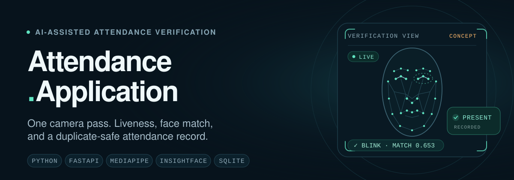
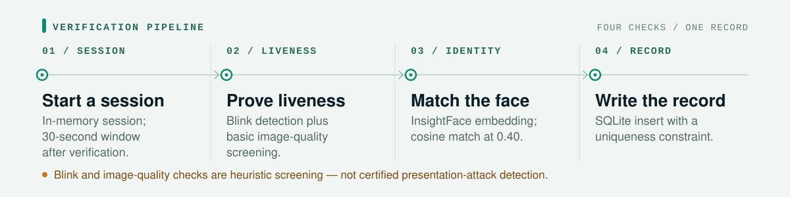

<p align="center">
  
</p>

<p align="center">
  <a href="#what-it-does">What it does</a> ·
  <a href="#how-verification-works">How it works</a> ·
  <a href="#api-surface">API</a> ·
  <a href="#status">Status</a> ·
  <a href="#setup-status">Setup</a> ·
  <a href="#documentation">Docs</a>
</p>

> [!WARNING]
> **Active development — not production-ready.** The feature code is present, but a fresh clone is not yet runnable: the dependency manifest and configuration are empty, the MediaPipe model path is machine-specific, and database initialization is not wired into startup. Runtime behavior is unverified. Track stabilization in [#13](https://github.com/Kartik-gharte/Attendance.Application/issues/13).

## What it does

Attendance.Application is a camera-based attendance verification backend built with FastAPI. It combines blink-based liveness, heuristic frame screening, InsightFace matching, and SQLite persistence.

The intended flow is narrow: establish presence, match identity, and write one attendance record. There is no web UI; the current client is a manual Python/OpenCV script.

- **Presence** — a face must produce a blink while basic image-quality screening passes. Both checks are heuristic, not certified presentation-attack detection.
- **Identity** — an InsightFace `buffalo_l` embedding is compared with the registered student embedding using cosine similarity at a `0.40` threshold.
- **Record** — a match is inserted into SQLite with a `UNIQUE (student_id, lecture_id, attendance_date)` constraint. Attendance can be queried by student or across all records.

## How verification works

<p align="center">
  
</p>

1. **Start a session** — `POST /liveness/start` creates an in-memory UUID session.
2. **Prove liveness** — `POST /liveness/frame` checks for a face, a blink, and basic frame quality. A blink plus the screening must pass for liveness to be verified.
3. **Match identity** — `POST /attendance/verify` requires a liveness-verified session no older than 30 seconds, extracts an InsightFace embedding, and compares it with the registered student embedding.
4. **Write one record** — a match inserts into SQLite; a duplicate is rejected by the unique constraint. Success and face rejection both consume the session.

Liveness sessions are process-local: they disappear on restart and are not shared between workers. The full response and failure behavior is documented in [docs/API_REFERENCE.md](docs/API_REFERENCE.md).

## API surface

| Method | Endpoint | Purpose | Auth |
| --- | --- | --- | --- |
| `GET` | `/` | Static service message; not a model/database readiness check | None |
| `POST` | `/liveness/start` | Create an in-memory liveness session | None |
| `POST` | `/liveness/frame` | Submit a webcam frame for liveness processing | None |
| `POST` | `/attendance/verify` | Verify liveness + face and attempt to mark attendance | None |
| `GET` | `/attendance/student/{student_id}` | List a student's attendance records | None |
| `GET` | `/attendance/all` | List all attendance records | None |

There is no authentication today. Application-level errors usually return HTTP `200` with `status: "error"`; missing form fields return HTTP `422`. Interactive OpenAPI docs are available at `/docs` and `/redoc` only after startup succeeds.

## Stack

| Layer | Tools |
| --- | --- |
| API | FastAPI, Uvicorn, `python-multipart` |
| Vision | OpenCV, MediaPipe, InsightFace, ONNX Runtime |
| Numerics | NumPy |
| Persistence | SQLite (Python standard library) |
| Manual client | OpenCV webcam capture, `requests` |

Dependency versions are not declared yet; runtime bootstrap is tracked in [#2](https://github.com/Kartik-gharte/Attendance.Application/issues/2).

## Status

The source contains these pieces, but end-to-end runtime behavior is unverified.

| Present in source | Not yet verified or missing |
| --- | --- |
| Blink-based liveness, EAR state machine, heuristic frame screening | Fresh-clone startup ([#2](https://github.com/Kartik-gharte/Attendance.Application/issues/2)) |
| InsightFace embeddings and `0.40` cosine matching | Runtime behavior of every endpoint |
| SQLite schema, inserts, duplicate constraint, queries | Database initialization at startup ([#3](https://github.com/Kartik-gharte/Attendance.Application/issues/3)) |
| Manual registration, camera, and API scripts | Auth ([#4](https://github.com/Kartik-gharte/Attendance.Application/issues/4)), retention/deletion ([#9](https://github.com/Kartik-gharte/Attendance.Application/issues/9)), automated tests/CI ([#7](https://github.com/Kartik-gharte/Attendance.Application/issues/7)) |

No benchmarked face-recognition accuracy, liveness performance, or presentation-attack resistance results exist. Stabilization work is sequenced in the [tracking backlog](https://github.com/Kartik-gharte/Attendance.Application/issues/13).

## Setup status

**There is no verified install or startup command yet.** A fresh clone is blocked by:

- Empty `requirements.txt` and `app/core/config.py`.
- A hardcoded Windows MediaPipe model path in `app/services/liveness.py`.
- `initialize_database()` not being called during application startup.
- Model assets and registered embeddings that are not included in the repository.

Start with [docs/SETUP.md](docs/SETUP.md), then the [stabilization backlog](https://github.com/Kartik-gharte/Attendance.Application/issues/13). The first runtime blockers are [#2](https://github.com/Kartik-gharte/Attendance.Application/issues/2) and [#3](https://github.com/Kartik-gharte/Attendance.Application/issues/3). Manual script requirements are in [docs/TESTING.md](docs/TESTING.md).

## Repository map

```text
Attendance.Application/
├── app/
│   ├── api/              # liveness and attendance routes
│   ├── database/         # SQLite schema and queries
│   ├── services/         # liveness, screening, matching, manual scripts
│   └── main.py           # FastAPI entry point
├── assets/readme/        # README visuals (static SVG)
├── docs/                 # setup, architecture, API, security, status
├── tests/services/       # manual camera/model scripts
├── test_api_attendance.py
├── test_liveness_service.py
├── requirements.txt      # currently empty
└── README.md
```

## Security & privacy

> [!CAUTION]
> This is biometric software under active development. Do not use real student faces, embeddings, or attendance records in development or public repositories.

- The API has no authentication or authorization. Liveness session IDs behave like short-lived bearer tokens and should not be logged.
- Anti-spoofing is heuristic blink and image-quality screening, not a trained or certified presentation-attack detection system.
- Liveness sessions live in process memory, are single-worker only, and expire 30 seconds after successful liveness verification.
- There is no biometric retention, deletion, or storage-protection policy yet; this is tracked in [#9](https://github.com/Kartik-gharte/Attendance.Application/issues/9).
- Face images, embeddings, model files, and local databases are excluded from Git. Never force-add them.

Read [docs/SECURITY_AND_PRIVACY.md](docs/SECURITY_AND_PRIVACY.md) before handling biometric data.

## Documentation

**Start here:** [Setup](docs/SETUP.md) · [Architecture](docs/ARCHITECTURE.md) · [API reference](docs/API_REFERENCE.md) · [Security & privacy](docs/SECURITY_AND_PRIVACY.md)

**Project state:** [Status](docs/PROJECT_STATUS.md) · [Known issues](docs/KNOWN_ISSUES.md) · [Roadmap](docs/ROADMAP.md) · [Full index](docs/README.md)

**Reference:** [Database](docs/DATABASE.md) · [Configuration](docs/CONFIGURATION.md) · [Testing](docs/TESTING.md) · [Decisions](docs/DECISIONS.md)

## Contributing

Start from a GitHub issue and a focused branch. Read [CONTRIBUTING.md](CONTRIBUTING.md) and [docs/DEVELOPMENT_WORKFLOW.md](docs/DEVELOPMENT_WORKFLOW.md). Do not commit secrets, biometric data, model files, or local databases.

## Maintainer

Kartik Gharte — [Kartik-gharte](https://github.com/Kartik-gharte)

## License

No license file is present. The project is currently presented as an academic and experimental project. Do not assume permission to reuse it beyond applicable law or the repository owner's instructions.
