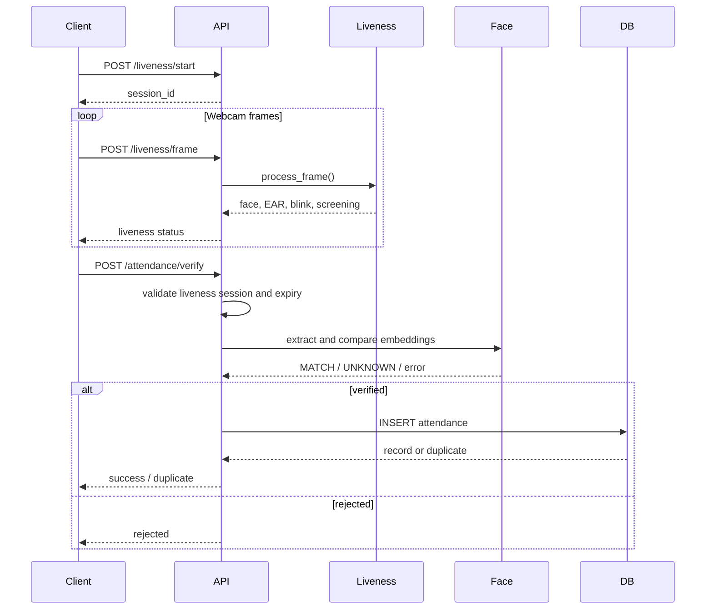

# Attendance.Application

Attendance.Application is an AI-assisted student attendance verification backend. It combines face recognition, blink-based liveness detection, basic image-quality screening, and SQLite attendance records to verify a student before marking attendance.

> **Project status:** the feature code is present on `main`, but runtime setup is not yet reproducible. The dependency manifest and configuration module are empty, the MediaPipe model path is Windows-specific, and database initialization is not wired into application startup. Treat the project as under active development and not production-ready.

## Overview

Traditional attendance is slow and easy to proxy. This project explores a camera-based flow:

1. A liveness session is created.
2. Webcam frames are checked for a face and a blink.
3. Basic image-quality screening runs alongside liveness detection.
4. A final image is compared with a previously registered face embedding.
5. Verified attendance is stored in SQLite, with duplicate protection per student, lecture, and date.

The current client is a manual Python/OpenCV script. There is no web frontend yet.

## Implemented capabilities

The following capabilities exist in the source code. Their runtime status is tracked in [docs/PROJECT_STATUS.md](docs/PROJECT_STATUS.md).

- UUID-based, in-memory liveness sessions.
- MediaPipe Face Landmarker integration for face landmarks.
- Eye Aspect Ratio (EAR) calculation and blink detection.
- Heuristic image-quality screening (face size, brightness, sharpness).
- InsightFace (`buffalo_l`) face embeddings.
- Cosine-similarity face matching with a `0.40` threshold.
- Combined liveness + face-match attendance decision.
- SQLite attendance persistence with a uniqueness constraint.
- Attendance retrieval by student and for all records.
- Manual scripts for face registration, recognition, liveness, and API testing.

## Technology stack

| Area | Technology |
| --- | --- |
| Language | Python |
| API | FastAPI, Uvicorn, `python-multipart` |
| Computer vision | OpenCV, MediaPipe, InsightFace, ONNX Runtime |
| Numerics | NumPy |
| Persistence | SQLite (Python standard library) |
| Manual client/tests | OpenCV webcam capture, `requests` |

Dependency versions are not currently declared. See [docs/SETUP.md](docs/SETUP.md) and [docs/KNOWN_ISSUES.md](docs/KNOWN_ISSUES.md).

## Verification flow



## Architecture at a glance

- `app/main.py` — FastAPI application, CORS, router registration.
- `app/api/liveness_routes.py` — liveness session and frame endpoints.
- `app/api/routes.py` — attendance verification and retrieval endpoints.
- `app/services/liveness.py` — MediaPipe landmarks, EAR, blink state.
- `app/services/anti_spoofing.py` — heuristic frame screening.
- `app/services/face_recognition.py` — InsightFace embeddings and similarity.
- `app/services/attendance_verification.py` — combines liveness and face results.
- `app/database/attendance_db.py` — SQLite connection, schema, inserts, queries.
- `app/services/register_face.py`, `recognize_face.py`, `combined_test.py` — manual scripts, not API endpoints.

See [docs/ARCHITECTURE.md](docs/ARCHITECTURE.md) for component responsibilities and data flow.

## Repository structure

```text
Attendance.Application/
├── app/
│   ├── api/              # FastAPI routes
│   ├── core/             # configuration module (currently empty)
│   ├── database/         # SQLite access and schema
│   ├── services/         # liveness, anti-spoofing, face recognition
│   └── main.py           # application entry point
├── tests/services/       # manual camera/model scripts (not pytest tests)
├── docs/                 # project documentation
├── test_api_attendance.py
├── test_liveness_service.py
├── requirements.txt      # currently empty
└── README.md
```

## Prerequisites

- The supported Python version has not been verified. The AI stack may require Python 3.10 or newer; confirm compatibility during Phase 1 runtime stabilization.
- A webcam for manual end-to-end testing.
- The MediaPipe Face Landmarker model file (`face_landmarker.task`). The current code expects a hardcoded Windows path; see [docs/CONFIGURATION.md](docs/CONFIGURATION.md).
- InsightFace `buffalo_l` model assets, loaded by name by the code.
- A registered face embedding for each student under `data/face_embeddings/<student_id>.npy`.
- SQLite is included with Python; no separate server is required.

## Setup and startup

Setup is **not yet reproducible**. The repository does not declare its dependencies, and the current model path and database initialization prevent a clean fresh-clone startup.

Do not treat an install command as verified until [docs/SETUP.md](docs/SETUP.md) is updated with a tested workflow. That document lists the blockers, expected assets, and the intended commands.

## API documentation

The endpoint reference is [docs/API_REFERENCE.md](docs/API_REFERENCE.md). When the application starts successfully, FastAPI also exposes interactive documentation at `/docs` and `/redoc`.

Current endpoints:

```text
GET  /
POST /liveness/start
POST /liveness/frame
POST /attendance/verify
GET  /attendance/student/{student_id}
GET  /attendance/all
```

## Testing

There is no automated pytest suite. The files named `test_*.py` are manual scripts that execute at import time and require a camera, model files, fixtures, and/or a running server.

See [docs/TESTING.md](docs/TESTING.md) for the current scripts, hardware requirements, known gaps, and the checks that can be run without model assets.

## Security and privacy

- Face embeddings, source images, local databases, and models are excluded from Git by `.gitignore`.
- The API currently has no authentication or authorization.
- Liveness sessions are stored in process memory and expire 30 seconds after verification.
- Anti-spoofing is heuristic image screening combined with a blink check. It is **not** a trained or certified presentation-attack detection system.
- Do not use real student biometric data in development or public repositories.

Read [docs/SECURITY_AND_PRIVACY.md](docs/SECURITY_AND_PRIVACY.md) before working with biometric data.

## Current limitations

- No web client or user interface.
- No authentication, authorization, or role model.
- No automated test suite, CI workflow, or reproducible test fixtures.
- No database migration system.
- No verified fresh-clone startup.
- No benchmarked face-recognition accuracy or liveness performance.
- Anti-spoofing is basic screening, not a trained PAD model.

## Contributing

Read [CONTRIBUTING.md](CONTRIBUTING.md) and [docs/DEVELOPMENT_WORKFLOW.md](docs/DEVELOPMENT_WORKFLOW.md). Work should start from a GitHub issue and use a focused branch. Do not commit credentials, biometric data, model files, or local databases.

## Documentation

| Document | Purpose |
| --- | --- |
| [docs/README.md](docs/README.md) | Documentation index |
| [docs/PROJECT_SPEC.md](docs/PROJECT_SPEC.md) | Scope and requirements with status |
| [docs/ARCHITECTURE.md](docs/ARCHITECTURE.md) | Components and data flow |
| [docs/API_REFERENCE.md](docs/API_REFERENCE.md) | Endpoint behavior |
| [docs/DATABASE.md](docs/DATABASE.md) | Schema and persistence |
| [docs/SETUP.md](docs/SETUP.md) | Setup status and prerequisites |
| [docs/CONFIGURATION.md](docs/CONFIGURATION.md) | Hardcoded settings and proposed config |
| [docs/TESTING.md](docs/TESTING.md) | Manual scripts and test gaps |
| [docs/SECURITY_AND_PRIVACY.md](docs/SECURITY_AND_PRIVACY.md) | Risks and data handling |
| [docs/ROADMAP.md](docs/ROADMAP.md) | Proposed phases and acceptance criteria |
| [docs/PROJECT_STATUS.md](docs/PROJECT_STATUS.md) | Current verified state |
| [docs/KNOWN_ISSUES.md](docs/KNOWN_ISSUES.md) | Confirmed outstanding issues |
| [docs/DECISIONS.md](docs/DECISIONS.md) | Decision log |
| [docs/plans/FOUNDATION_PLAN.md](docs/plans/FOUNDATION_PLAN.md) | This foundation task |

## Maintainer

Kartik Gharte — [Kartik-gharte](https://github.com/Kartik-gharte)

## License

No license file is present in this repository. The project is currently presented as an academic and experimental project. Do not assume permission to reuse it beyond applicable law or the repository owner's instructions.
