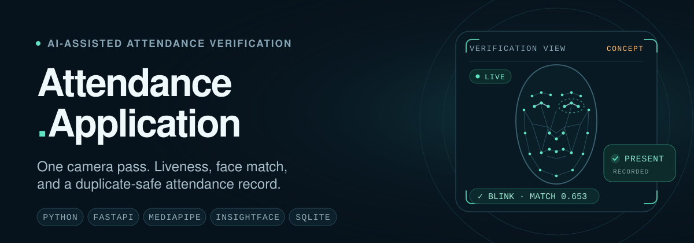
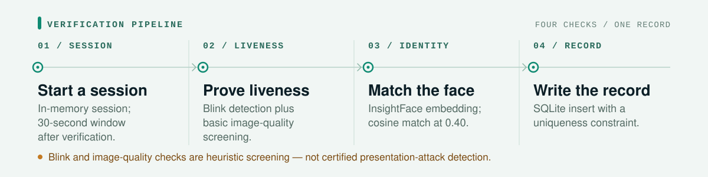

<p align="center">
  
</p>

<p align="center">
  <a href="#what-it-does">What it does</a> ·
  <a href="#how-verification-works">How it works</a> ·
  <a href="#api-surface">API</a> ·
  <a href="#status">Status</a> ·
  <a href="#setup-status">Setup</a> ·
  <a href="#documentation">Docs</a>
</p>

> [!WARNING]
> **Active development — not production-ready.** Runtime bootstrap (pinned dependencies, configuration, portable model paths, lifespan-managed services), input validation, upload limits, stable error responses, local-account authentication with bearer tokens and role-based attendance authorization, structured redacted logging, versioned schema migrations, backup and restore, health and readiness probes, and a metrics endpoint are implemented and verified on macOS arm64 with Python 3.11. TLS, rate limiting, MFA/SSO, backup encryption, and a measured face-recognition accuracy remain open. Track stabilization in [#13](https://github.com/Kartik-gharte/Attendance.Application/issues/13).

## What it does

Attendance.Application is a camera-based attendance verification backend built with FastAPI. It combines blink-based liveness, heuristic frame screening, InsightFace matching, and SQLite persistence.

The intended flow is narrow: establish presence, match identity, and write one attendance record. There is no web UI; the current client is a manual Python/OpenCV script whose values are configurable through arguments or environment variables.

- **Presence** — a face must produce a blink while basic image-quality screening passes. Both checks are heuristic, not certified presentation-attack detection.
- **Identity** — an InsightFace `buffalo_l` embedding is compared with the registered student embedding using cosine similarity at a configurable threshold (default `0.40`).
- **Record** — a match is inserted into SQLite with a `UNIQUE (student_id, lecture_id, attendance_date)` constraint. Attendance can be queried by student or across all records.
- **Traceability** — every enrollment is recorded with the operator and the consent reference. The audit trail holds no biometric material.

## How verification works

<p align="center">
  
</p>

1. **Authenticate** — `POST /auth/token` exchanges a locally provisioned username/password for an opaque bearer token. Tokens expire and can be revoked.
2. **Start a session** — `POST /liveness/start` creates an in-memory UUID session bound to the authenticated student.
3. **Prove liveness** — `POST /liveness/frame` checks for a face, a blink, and basic frame quality. A blink plus the screening must pass for liveness to be verified.
4. **Match identity** — `POST /attendance/verify` requires a liveness-verified session owned by the same student, created no longer than `LIVENESS_VALIDITY_SECONDS` ago (default 30 seconds), and a `student_id` matching the authenticated account. It extracts an InsightFace embedding and compares it with the registered student embedding.
5. **Write one record** — a match inserts into SQLite; a duplicate is rejected by the unique constraint. Every attempt consumes the session, so it cannot be replayed.

Liveness sessions are process-local: they disappear on restart and are not shared between workers, so the service must run with a single worker. Students can mark and read only their own attendance; admins can read attendance but cannot mark it. The full response and failure behavior is documented in [docs/API_REFERENCE.md](docs/API_REFERENCE.md).

## API surface

| Method | Endpoint | Purpose | Auth |
| --- | --- | --- | --- |
| `GET` | `/` | Static service message; not a model/database readiness check | Public |
| `POST` | `/auth/token` | Exchange username/password for a bearer token | Public |
| `GET` | `/auth/me` | Return the current account | Bearer |
| `POST` | `/auth/logout` | Revoke the current token | Bearer |
| `POST` | `/liveness/start` | Create a user-bound liveness session | Bearer, student |
| `POST` | `/liveness/frame` | Submit a webcam frame for liveness processing | Bearer, student and session owner |
| `POST` | `/attendance/verify` | Verify liveness + face and attempt to mark attendance | Bearer, student; matching `student_id` |
| `GET` | `/attendance/student/{student_id}` | List a student's attendance records | Bearer, student self or admin |
| `GET` | `/attendance/all` | List all attendance records | Bearer, admin |
| `GET` | `/health/live` | Liveness probe; restart the process if it fails | Public |
| `GET` | `/health/ready` | Readiness probe; drain the instance if it fails | Public |
| `GET` | `/metrics` | Operational metrics in the Prometheus text format | Public |

Accounts are provisioned locally with `python -m app.auth.cli`; there is no public signup. Unauthenticated protected requests return HTTP `401`; wrong-role or cross-student requests return `403`. Application-level validation errors usually return HTTP `200` with `status: "error"`; missing form fields return HTTP `422`. Interactive OpenAPI docs are available at `/docs` and `/redoc` only after startup succeeds.

The three public operational endpoints expose status only. The metric route label is always the route template, so a student identifier never reaches the metrics.

## Stack

| Layer | Tools |
| --- | --- |
| API | FastAPI, Uvicorn, `python-multipart` |
| Configuration | `pydantic-settings`, `.env` |
| Auth | Local SQLite accounts, `argon2-cffi`, opaque bearer tokens |
| Vision | OpenCV, MediaPipe, InsightFace, ONNX Runtime |
| Numerics | NumPy |
| Persistence | SQLite (Python standard library) |
| Observability | Standard library `logging` with a redaction filter, Prometheus text metrics |
| Manual client | OpenCV webcam capture, `requests` |

Direct dependencies are pinned in [`requirements.txt`](requirements.txt); the verified platform is Python 3.11.16 on macOS arm64. See [Setup](docs/SETUP.md) for model provisioning and startup commands.

## Status

The runtime, the API surface, the authentication and authorization controls, the operational tooling, and the deployment baseline are verified locally. The camera-based end-to-end flow and the production security controls are not.

| Verified locally | Still missing or unverified |
| --- | --- |
| Pinned dependencies, validated settings, `.env` support | End-to-end liveness → face match → attendance flow with a consented face |
| Startup, `GET /`, `GET /docs`, database initialization, missing-model failure | TLS, rate limiting, account lockout, MFA/SSO |
| One MediaPipe and one InsightFace load per process | Measured face-recognition accuracy and presentation-attack resistance ([#11](https://github.com/Kartik-gharte/Attendance.Application/issues/11)) |
| Local login/logout, token expiry/revocation, student self-access, admin read-only access | Backup encryption at rest, an automatic backup schedule |
| Structured redacted logging; no credential, session identifier, or embedding reaches a log | Enforced branch protection on `main` |
| Versioned schema migrations, with rollback on a failed migration | An audit trail for attendance reads and writes |
| Backup and restore with a checksummed manifest and a verified restore | Tracing and alerting |
| Health and readiness probes; a dependency failure does not report the process dead | A multi-worker deployment with a shared liveness session store |
| Metrics with route labels that cannot contain personal data | |
| Enrollment audit trail and a consent reference | |
| Attendance retention and deletion, applied to the records and the audit trail | |
| 258 runtime tests and CI compile, test, and secret-scan checks on every pull request | |

No benchmarked face-recognition accuracy, liveness performance, or presentation-attack resistance results exist. The evaluation machinery is built and tested, but no consented dataset is available, so no measurement has been made. Stabilization work is sequenced in the [tracking backlog](https://github.com/Kartik-gharte/Attendance.Application/issues/13).

## Setup status

Install and startup are verified on **Python 3.11.16 / macOS arm64** with the pinned manifest. Model assets are not committed and must be provisioned locally:

- MediaPipe `face_landmarker.task` must be downloaded or supplied via `MEDIAPIPE_FACE_LANDMARKER_MODEL`.
- InsightFace `buffalo_l` is downloaded on first startup or provisioned in `INSIGHTFACE_ROOT`.
- Registered embeddings are required for face matching and must never be committed.
- The FastAPI lifespan applies the pending schema migrations for the configured database path and uses that path for attendance writes, retrieval, and authentication.
- Local accounts are provisioned with `python -m app.auth.cli`; there is no public signup.
- Face embeddings are enrolled with `python -m app.services.register_face`, which requires the operator and the consent reference so that the enrollment can be traced.

Follow [docs/SETUP.md](docs/SETUP.md) for commands and [docs/CONFIGURATION.md](docs/CONFIGURATION.md) for environment variables. The deployment baseline, the runbook, and the measured resource footprint are in [docs/DEPLOYMENT.md](docs/DEPLOYMENT.md). Manual script requirements are in [docs/TESTING.md](docs/TESTING.md).

## Repository map

```text
Attendance.Application/
├── app/
│   ├── api/              # liveness, attendance, health, and metrics routes
│   ├── auth/             # accounts, tokens, dependencies, routes, CLI
│   ├── core/             # configuration, logging, metrics, service wiring
│   ├── database/         # SQLite schema, migrations, and backup
│   ├── evaluation/       # accuracy evaluation harness and runner
│   ├── services/         # liveness, screening, matching, enrollment, audit
│   └── main.py           # FastAPI entry point
├── assets/readme/        # README visuals (static SVG)
├── data/                 # database and face embeddings (not committed)
├── docs/                 # setup, architecture, API, security, deployment, status
├── manual/               # opt-in camera and API client scripts
├── models/               # MediaPipe model assets (not committed)
├── tests/runtime/        # 258 deterministic tests
├── requirements.txt      # pinned runtime dependencies
└── README.md
```

## Security & privacy

> [!CAUTION]
> This is biometric software under active development. Do not use real student faces, embeddings, or attendance records in development or public repositories.

- The API uses local accounts and opaque bearer tokens. Students can mark/read only their own attendance; admins can read attendance. TLS, rate limiting, account lockout, and MFA/SSO are not implemented, so do not treat this as a production authentication system.
- Logs are structured and redacted. Bearer tokens, passwords, API keys, liveness session identifiers, and embedding vectors are masked before any handler receives them, so a session identifier cannot be logged even by accident.
- Anti-spoofing is heuristic blink and image-quality screening, not a trained or certified presentation-attack detection system. Its effectiveness has not been measured.
- Liveness sessions live in process memory, are single-worker only, expire `LIVENESS_VALIDITY_SECONDS` after creation (default 30 seconds), and are consumed by the first attendance attempt.
- Biometric retention and deletion are implemented and cover the attendance records, the enrollment audit trail, and the backups.
- Every enrollment is recorded with the operator and a consent reference. The audit trail holds no image, embedding, or face crop.
- Face images, embeddings, model files, and local databases are excluded from Git. Never force-add them.

Read [docs/SECURITY_AND_PRIVACY.md](docs/SECURITY_AND_PRIVACY.md) before handling biometric data.

## Documentation

**Start here:** [Setup](docs/SETUP.md) · [Architecture](docs/ARCHITECTURE.md) · [API reference](docs/API_REFERENCE.md) · [Security & privacy](docs/SECURITY_AND_PRIVACY.md)

**Project state:** [Status](docs/PROJECT_STATUS.md) · [Known issues](docs/KNOWN_ISSUES.md) · [Roadmap](docs/ROADMAP.md) · [Full index](docs/README.md)

**Reference:** [Database](docs/DATABASE.md) · [Configuration](docs/CONFIGURATION.md) · [Deployment](docs/DEPLOYMENT.md) · [Testing](docs/TESTING.md) · [Decisions](docs/DECISIONS.md)

## Contributing

Start from a GitHub issue and a focused branch. Read [CONTRIBUTING.md](CONTRIBUTING.md) and [docs/DEVELOPMENT_WORKFLOW.md](docs/DEVELOPMENT_WORKFLOW.md). Prefer multiple small, coherent contributions (focused commits and, when practical, separate PRs) over one large change. Do not commit secrets, biometric data, model files, or local databases.

## Maintainer

Kartik Gharte — [Kartik-gharte](https://github.com/Kartik-gharte)

## License

No license file is present. The project is currently presented as an academic and experimental project. Do not assume permission to reuse it beyond applicable law or the repository owner's instructions.
