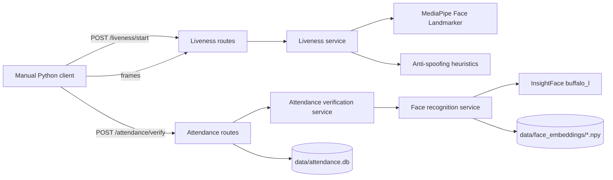

# Architecture

## Overview

Attendance.Application is a single FastAPI application. It exposes liveness and attendance endpoints, loads computer-vision models in process, and persists attendance records in a local SQLite database. The current client is a manual OpenCV script, not a web application.

## Entry point

`app/main.py`:

- Exposes `create_app(settings=None, service_factory=build_services)` for explicit app construction and testing.
- Loads validated settings from `app/core/config.py`.
- Configures CORS from `CORS_ALLOWED_ORIGINS`, with credentials enabled and all methods/headers allowed.
- Registers the attendance router and the liveness router.
- Exposes `GET /`.
- Creates the module-level `app = create_app()` used by Uvicorn.

Importing `app.main` does **not** load model assets. Models are created once,
inside the FastAPI lifespan, when the server starts. `build_services()` creates
one `LivenessService`, one `FaceRecognitionService`, and one
`AttendanceVerificationService` that shares the same liveness and face
instances. Services are stored on `app.state` and the MediaPipe detector is
closed on shutdown.

If the MediaPipe model is missing, lifespan startup raises a `RuntimeError`
naming `MEDIAPIPE_FACE_LANDMARKER_MODEL`, so the process exits before serving
requests.

## Components

| Component | Responsibility | Current constraints |
| --- | --- | --- |
| `app/api/liveness_routes.py` | Session creation, frame decoding, session state, liveness responses. | In-memory `sessions` dict; single process; configurable validity (default 30 seconds); uses the shared service from `app.state`. |
| `app/api/routes.py` | Attendance verification, temporary image handling, database insert, attendance retrieval. | Uses the shared service from `app.state`; synchronous SQLite calls in an async handler; no authentication. |
| `app/services/liveness.py` | MediaPipe Face Landmarker, Eye Aspect Ratio, blink state machine, anti-spoofing invocation. | Model path comes from `MEDIAPIPE_FACE_LANDMARKER_MODEL`; fails fast if the file is missing. |
| `app/services/anti_spoofing.py` | Face-size, brightness, and Laplacian-variance screening. | Heuristic only; not a trained presentation-attack detector. |
| `app/services/face_recognition.py` | InsightFace embedding extraction, multi-attempt detection, cosine similarity, registered-embedding loading. | Model name/cache/threshold/embedding directory come from settings; raises on missing/empty assets. |
| `app/services/attendance_verification.py` | Combines liveness and face results into a final attendance decision. | Accepts shared service instances; standalone construction still works for manual scripts. |
| `app/database/attendance_db.py` | SQLite connection, schema definition, insert/query helpers, duplicate detection. | Path comes from `ATTENDANCE_DB_PATH`; schema creation helper is not called at startup; local time without timezone; no migrations. |
| `app/core/config.py` | Validated settings loaded from environment variables and `.env`. | Defaults are project-relative; model existence is checked at startup, not at config import. |
| `app/services/register_face.py` | Manual face-registration script. | Hardcoded student ID, input filename, and relative output path; not an API. |
| `app/services/recognize_face.py` | Manual recognition script. | Hardcoded paths and student ID; not an API. |
| `app/services/combined_test.py` | Standalone camera test combining liveness and recognition. | Windows-specific paths; duplicates logic from services; not part of the API. |
| `test_api_attendance.py` | Manual end-to-end API client. | Requires running server, camera, `requests`, and registered embedding. |

## Liveness flow

1. `POST /liveness/start` creates a UUID and stores:
   - `closed_frames = 0`
   - `eyes_closed = False`
   - `liveness_verified = False`
   - `verified_at = None`
2. `POST /liveness/frame` decodes the uploaded JPEG/PNG with OpenCV and calls `LivenessService.process_frame`.
3. MediaPipe returns landmarks for at most one face.
4. `AntiSpoofingService.check_frame` evaluates face size, brightness, and sharpness.
5. Eye Aspect Ratio is calculated. Four consecutive closed-eye frames set `eyes_closed`; the next open-eye frame is a blink.
6. Liveness is verified only when a blink occurs **and** the anti-spoofing screening passes.
7. The route stores `liveness_verified` and `verified_at`. The response exposes EAR, blink state, and liveness status, but **not** the anti-spoofing details, which remain internal to the service result.

The liveness session is a bearer-like identifier: anyone who knows a session ID and can call the API can use it until it expires or is consumed.

## Attendance flow

1. `POST /attendance/verify` requires `student_id`, `session_id`, `subject`, `lecture_id`, and an image.
2. The route validates that the session exists, is liveness-verified, has a timestamp, and is not older than `LIVENESS_VALIDITY_SECONDS` (default 30).
3. The uploaded image is written to a temporary file and passed to `AttendanceVerificationService.verify_face`.
4. `FaceRecognitionService.recognize` loads the image, extracts an embedding using up to five detection attempts, loads `<FACE_EMBEDDING_DIR>/<student_id>.npy`, and computes cosine similarity.
5. A similarity of at least `FACE_MATCH_THRESHOLD` (default `0.40`) is considered a `MATCH`.
6. The route combines the face result with the already-validated liveness session. A non-match returns `rejected` and consumes the session.
7. On a match, `mark_attendance` inserts a row. A uniqueness conflict returns a duplicate result. The session is consumed in both cases.
8. The temporary file is deleted in `finally`.

## Startup and configuration

- `create_app()` loads a `Settings` object from environment variables and an optional project-root `.env` file.
- The FastAPI lifespan calls `build_services(settings)` once, after settings validation and before serving requests.
- `LivenessService` reads `MEDIAPIPE_FACE_LANDMARKER_MODEL` and raises an actionable error if the file is missing.
- `FaceRecognitionService` reads `INSIGHTFACE_MODEL_NAME`, `INSIGHTFACE_ROOT`, `FACE_MATCH_THRESHOLD`, and `FACE_EMBEDDING_DIR`.
- `AttendanceVerificationService` receives the same liveness and face instances used by the routes; services are not duplicated at import.
- `app/database/attendance_db.py` reads `ATTENDANCE_DB_PATH`, but `initialize_database()` is still not called by the application ([#3](https://github.com/Kartik-gharte/Attendance.Application/issues/3)).

Runtime dependencies are pinned in `requirements.txt`; development dependencies are in `requirements-dev.txt`. The verified platform is documented in [SETUP.md](SETUP.md).

## Current vs future architecture

**Current:** local single-process FastAPI app, in-memory sessions, local model assets, local SQLite, no authentication, manual client.

**Proposed future (not implemented):**

- Readiness/health endpoints that report model and database state.
- Shared session storage (for multiple workers) with expiry and one-time use.
- Authentication and role-based authorization.
- Async or thread-safe database access and migrations.
- Automated tests with mocked models for API and database logic.
- A web client built against a stable API contract.
- A trained presentation-attack detection component, subject to evaluation.

Do not describe any proposed item as implemented until code and tests support it.
