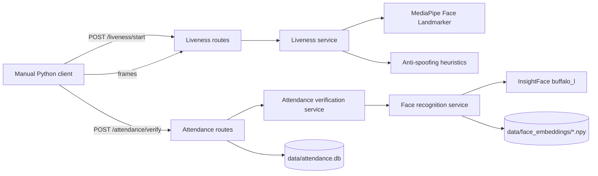

# Architecture

## Overview

Attendance.Application is a single FastAPI application. It exposes liveness and attendance endpoints, loads computer-vision models in process, and persists attendance records in a local SQLite database. The current client is a manual OpenCV script, not a web application.

## Entry point

`app/main.py`:

- Creates the FastAPI application (`title="AI Attendance System"`, `version="1.0.0"`).
- Configures CORS for `127.0.0.1`/`localhost` on ports `5500` and `5173`, with credentials enabled and all methods/headers allowed.
- Registers the attendance router and the liveness router.
- Exposes `GET /`.

Importing the application has side effects: both routers construct service objects at module import time, which loads MediaPipe and InsightFace models. A missing model therefore prevents the application from importing and starting.

## Components

| Component | Responsibility | Current constraints |
| --- | --- | --- |
| `app/api/liveness_routes.py` | Session creation, frame decoding, session state, liveness responses. | In-memory `sessions` dict; single process; 30-second validity; constructs a `LivenessService` at import. |
| `app/api/routes.py` | Attendance verification, temporary image handling, database insert, attendance retrieval. | Constructs `AttendanceVerificationService` at import; synchronous SQLite calls in an async handler; no authentication. |
| `app/services/liveness.py` | MediaPipe Face Landmarker, Eye Aspect Ratio, blink state machine, anti-spoofing invocation. | Hardcoded Windows model path; two-frame-state values passed by the route. |
| `app/services/anti_spoofing.py` | Face-size, brightness, and Laplacian-variance screening. | Heuristic only; not a trained presentation-attack detector. |
| `app/services/face_recognition.py` | InsightFace embedding extraction, multi-attempt detection, cosine similarity, registered-embedding loading. | Loads `buffalo_l`; hardcoded `data/face_embeddings/<id>.npy`; threshold `0.40`; raises on missing/empty assets. |
| `app/services/attendance_verification.py` | Combines liveness and face results into a final attendance decision. | Constructs both liveness and face services; no independent anti-spoofing verdict beyond liveness state. |
| `app/database/attendance_db.py` | SQLite connection, schema definition, insert/query helpers, duplicate detection. | Schema creation helper is not called at startup; local time without timezone; no migrations. |
| `app/core/config.py` | Intended configuration module. | Empty; all settings are hardcoded elsewhere. |
| `app/services/register_face.py` | Manual face-registration script. | Hardcoded student ID, input filename, and relative output path; not an API. |
| `app/services/recognize_face.py` | Manual recognition script. | Hardcoded paths and student ID; not an API. |
| `app/services/combined_test.py` | Standalone camera test combining liveness and recognition. | Windows-specific paths; duplicates logic from services; not part of the API. |
| `test_api_attendance.py` | Manual end-to-end API client. | Requires running server, camera, `requests`, and registered embedding. |

## Liveness flow

1. `POST /liveness/start` creates a UUID and stores:
   - `closed_frames = 0`
   - `eyes_closed = False`
   - `liveness_verified = False`
   - `verified_at = None`
2. `POST /liveness/frame` decodes the uploaded JPEG/PNG with OpenCV and calls `LivenessService.process_frame`.
3. MediaPipe returns landmarks for at most one face.
4. `AntiSpoofingService.check_frame` evaluates face size, brightness, and sharpness.
5. Eye Aspect Ratio is calculated. Four consecutive closed-eye frames set `eyes_closed`; the next open-eye frame is a blink.
6. Liveness is verified only when a blink occurs **and** the anti-spoofing screening passes.
7. The route stores `liveness_verified` and `verified_at`. The response exposes EAR, blink state, and liveness status, but **not** the anti-spoofing details, which remain internal to the service result.

The liveness session is a bearer-like identifier: anyone who knows a session ID and can call the API can use it until it expires or is consumed.

## Attendance flow

1. `POST /attendance/verify` requires `student_id`, `session_id`, `subject`, `lecture_id`, and an image.
2. The route validates that the session exists, is liveness-verified, has a timestamp, and is not older than 30 seconds.
3. The uploaded image is written to a temporary file and passed to `AttendanceVerificationService.verify_face`.
4. `FaceRecognitionService.recognize` loads the image, extracts an embedding using up to five detection attempts, loads `data/face_embeddings/<student_id>.npy`, and computes cosine similarity.
5. A similarity of at least `0.40` is considered a `MATCH`.
6. The route combines the face result with the already-validated liveness session. A non-match returns `rejected` and consumes the session.
7. On a match, `mark_attendance` inserts a row. A uniqueness conflict returns a duplicate result. The session is consumed in both cases.
8. The temporary file is deleted in `finally`.

## Startup and configuration

- `app/api/routes.py:22` instantiates `AttendanceVerificationService` at import.
- That service constructs a `LivenessService` and a `FaceRecognitionService`.
- `app/api/liveness_routes.py:12` constructs a second `LivenessService`.
- `LivenessService` reads a hardcoded Windows model path (`app/services/liveness.py:13`).
- `requirements.txt` is empty; `app/core/config.py` is empty.
- `initialize_database()` exists in `app/database/attendance_db.py:40` but is not called by the application.

These are current implementation facts, not a recommended design. Phase 1 of the [roadmap](ROADMAP.md) covers portable configuration, dependency declaration, and reliable startup.

## Current vs future architecture

**Current:** local single-process FastAPI app, in-memory sessions, local model assets, local SQLite, no authentication, manual client.

**Proposed future (not implemented):**

- Configuration via environment variables and a validated settings object.
- Lazy model loading with explicit readiness/error handling.
- Shared session storage (for multiple workers) with expiry and one-time use.
- Authentication and role-based authorization.
- Async or thread-safe database access and migrations.
- Automated tests with mocked models for API and database logic.
- A web client built against a stable API contract.
- A trained presentation-attack detection component, subject to evaluation.

Do not describe any proposed item as implemented until code and tests support it.
